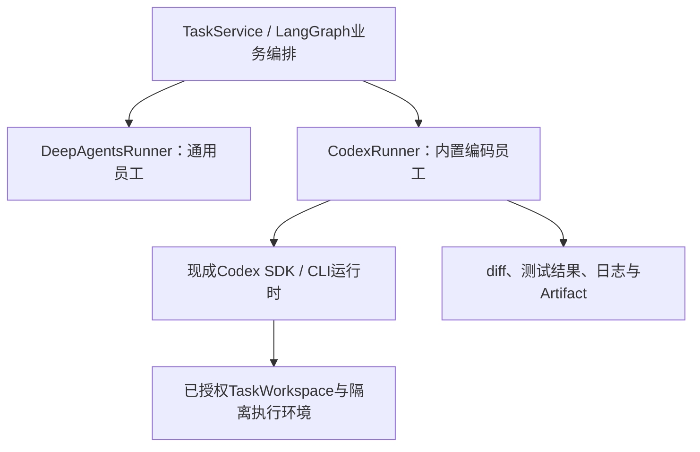

# 内置 Codex 编码执行器

状态：设计澄清，尚未实现；日期：2026-11-15。用户明确：直接复用现成Codex作为Coding Agent，不自行建设编码Agent内核。本页补充原基线并收敛WP-04/11，任务与权限权威仍为[领域合同](../domain-model.md)。

## 产品分工

- 云端数字员工承担研究、分析、内容、统筹及编码工作，首版团队员工执行位置为cloud。
- 个人助手可选local/cloud。本地用于未上传文件、本机软件、本地代码或内网；云端员工需要这些能力时向获授权个人助手委派。
- 编码员工是内置的可调度员工，其执行器为Codex。Creator无需生成另一套编程Agent，只负责组织需求、选择工具、委派编码、校验产物和发布。

## 执行分层

LangGraph/Deep Agents仍为主业务编排与通用执行栈。Codex是专用编码执行器，不替换产品身份、任务、审阅和发布服务；不重写Codex内部模型循环、代码编辑、工具选择和上下文管理。

## 集成方式与M0门槛

首版优先评估官方Codex SDK的启动、续接、事件与取消能力；需要更完整的原生审批和会话控制时评估app-server。SDK/CLI进程在所选执行主机运行：cloud任务部署在云端隔离环境，local任务运行于获授权本机环境。

官方资料确认SDK可程序化嵌入，app-server面向会话、审批和事件的深度集成；本项目具体版本、Python接口、传输和支持边界由M0实测后锁定。[Codex SDK](https://learn.chatgpt.com/docs/codex-sdk)、[App Server](https://learn.chatgpt.com/docs/app-server)、[集成层选择](https://developers.openai.com/blog/codex-as-a-platform)

M0增加：在受限目录中修改一个示例模块并运行测试；收集真实文件diff、测试退出码、事件和原生会话ID；验证中断/重启/续接；检查原生权限和网络策略；验证凭据不进入Agent产物。M0不通过时明确缺口，不能改写成“自研Coding Agent”来隐瞒失败。

模型、账号、认证方式和费用单独配置。内置开源运行时不等于随产品附送模型或托管服务，不能复制开发者私人登录态到所有员工。

## CodingJob合同

每项编码任务包含：目标与验收、输入版本/仓库快照、允许工作目录、允许命令与网络、依赖安装策略、预算/deadline、工具/账号权限。Task固定runtime_profile=`codex.sdk.v1`，ExecutionSession保存原生thread映射及可恢复状态引用。

输出必须含：文件变更与hash、测试命令/退出码/结果、失败说明、必要日志和产物；不能只采信Codex自然语言“测试通过”。平台独立执行必要验证，决定review、发布和复用。

跨员工调用通过显式子Task，不在Deep Agents的一个普通工具里启动无法追踪的长进程。Codex会话不是LangGraph checkpoint；分别持久化和恢复，不能承诺互相反序列化。

## 权限与恢复边界

自有Deep Agents工具继续逐调用经过ToolGateway。Codex内部工具由原生harness运行，平台不能声称每个原生调用都经过自有网关。平台在CodingJob边界授权，配合Codex原生审批、目录/进程/网络隔离和产物发布校验。

原生审批必须能够上报并绑定动作/参数，或将相应外部动作禁用。首版编码作业只允许任务工作区修改和测试，不提供生产写入、外发或发布凭据；正式工具发布仍经过本平台发布服务。

Codex原生会话/进程无法可靠取消或续接时，记录真实状态，保留diff和测试结果；未知外部动作进入recovery_required。lease/fence限制新作业派发与正式结果提交，不能撤回已经开始的原生命令。

原生内部调用次数不一定可完全计量；job按可验证时长/费用/原生用量限制，不将缺失数据当零。平台可观察的调用次数与Codex内部统计分开记账，无法提供必要控制时该执行配置不可发布。

## Creator闭环与范围

Creator发现能力缺口 -> 创建Codex编码子Task -> 在隔离环境生成工具包/manifest/测试 -> 独立验证 -> 登记能力新版本 -> 装配员工 -> 发布。简单固定数据计算仍可使用受控Python执行工具，它不是另建编码Agent。

Codex桌面应用完整UI不作为嵌入对象；Web工作台展示统一任务、diff、测试、审批和产物。以后可增加其他现成编码执行器，首版只接Codex，不做多品牌适配平台。
