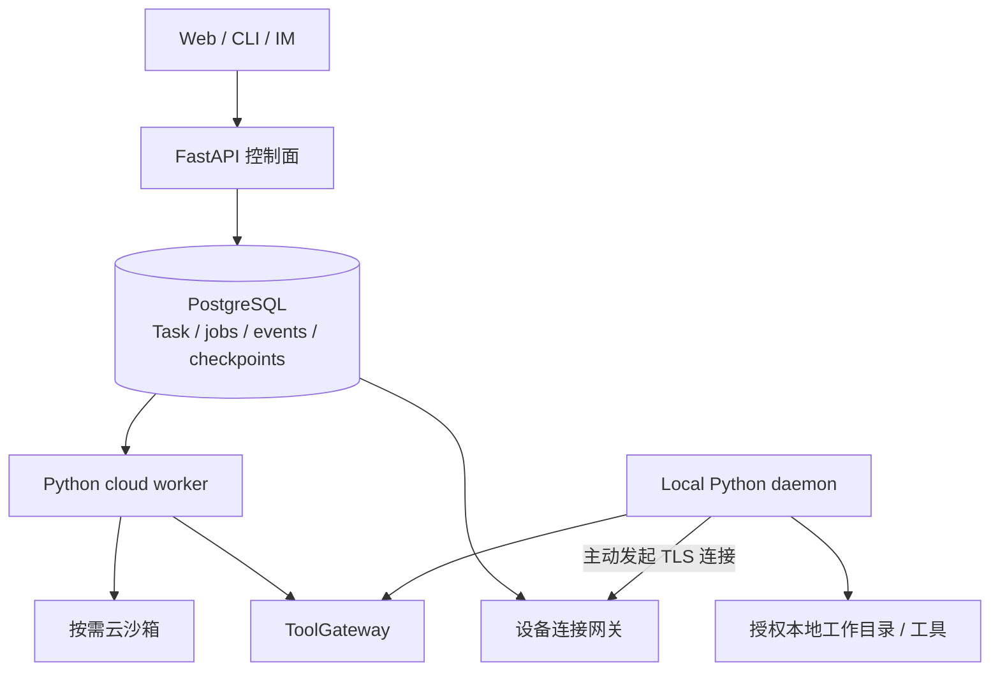

# 执行环境与沙箱生命周期

状态：v0.1 设计基线，尚未实现。日期：2026-11-15。业务状态、实体及唯一约束以[领域模型](../domain-model.md)为准，设备帧以[API 合同](../api-and-events.md)为准。

## 1. 已确定的部署语义

个人助手／组织员工描述 AgentInstance 的归属；`local/cloud` 描述一个 Task 的执行位置。同一个个人助手可以负责本地任务，也可以显式创建云任务。首版组织员工部署在cloud，需要本机能力时向获授权个人助手委派；不将数字员工直接部署到用户设备。

用户在任务创建前选择位置，服务端固定 `execution`、负责人、revision、输入授权和预算。任务执行中不自动改变位置，不因设备离线把本地任务转云。云任务由独立 worker 执行，用户离线、关闭网页或关闭个人电脑不影响已受理的云任务。

图中的同一控制面不代表同一个权限域。个人 Space 与团队 Space 各有 `tenant_id=space_id`；跨 Space 委派经过 DelegationRequest，不能直接复用另一方 session、凭据或数据库查询权限。

## 2. 持久对象与临时资源

| 对象 | 绑定关系 | 生命周期 |
| --- | --- | --- |
| AgentInstance | Space、owner、revision 默认值、记忆 namespace | 长期身份；没有任务时不要求常驻进程或 VM |
| Task | 单负责人、固定 execution、目标、输入和预算 | 从 queued 到终态，可经历等待、返工与多个 attempt |
| ExecutionSession | `(tenant_id, agent_instance_id, task_id)` 唯一 | 私有上下文与框架 thread 映射；跨 attempt 保留 |
| RunAttempt | session、attempt_no、有效 lease 和 fence | 一次可恢复执行段；结束或失去执行权后不能再发布结果 |
| TaskWorkspace | Space、Task、location、storage_ref、manifest_version | 持久工作文件；不依附某个容器 ID |
| SandboxLease | ExecutionSession、provider、environment_id | 按需租用的计算；完成或空闲后可释放 |

这里的 `tenant_id` 对应领域模型的 `space_id`。framework thread ID 由服务端生成，外部请求不能自行指定并越过上述映射。

默认粒度是 **一个 TaskWorkspace 对应一项任务的工作文件，一个 ExecutionSession 租用执行环境**。一个 session 可以先后租用不同环境，但必须从已验证 checkpoint 和文件版本恢复；同一时刻最多一个有效 RunAttempt。不要按每个模型调用或每个工具调用都重建环境。

Conversation 只负责群聊／私聊与消息；一个群里的不同任务分别有 session 和 workspace。Agent 的长期记忆不放在唯一的沙箱磁盘上。专属持久桌面、长驻浏览器及 sticky 环境后置，不能成为默认恢复的前提。

## 3. 本地与云端存储

云 TaskWorkspace 通过持久卷或受控对象存储 manifest 保存，计算环境挂载／恢复工作副本。产物发布为不可变 ArtifactVersion；workspace 中未发布的临时文件不自动成为跨 Space 可见结果。

本地 TaskWorkspace 驻留已配对设备的授权根目录中，由 daemon 管理路径映射。控制面保存状态与引用，不默认同步整个本机目录、私有文件或浏览器 profile。磁盘故障导致未备份本地文件丢失时，不能宣称能从云上聊天历史完整恢复。

本地执行不等于使用离线模型。若调用云模型，所选文件片段/工具结果仍可能发送给模型服务，必须在个人授权与数据策略中明确；不把“未同步全盘”宣传为“数据完全不出本机”。

本机 manifest 保存 `file_token/root_id/relative_path` 映射；云端仅登记经批准的设备、root ID、opaque file_token、hash、大小等元数据与ACL，不保存原始绝对路径或文件正文。读取时重新验证文件版本和根目录边界；详细登记合同见[设备协议](../api-and-events.md)。

graph checkpoint、Task 业务状态、workspace 文件 manifest 分开持久化。只有工具结果与对应文件版本均写入后，才把 checkpoint 标为可恢复。checkpoint 不保存长期主凭据；运行中的进程、文件句柄、浏览器操作和已发出的外部请求不能只靠反序列化 graph 状态恢复。

## 4. 云沙箱租用流程

1. 调度器校验 Task、权限、预算和容量，在一个事务中创建 RunAttempt、增加 fence、领取 lease。
2. API-only 能力通过 ToolGateway 执行，无需启动沙箱。需要文件、shell 或浏览器时，才创建 session 对应的 SandboxLease。
3. 从固定工具锁定清单、受控环境模板与 TaskWorkspace manifest 准备环境；拒绝任意宿主机挂载和跨 Space workspace 引用。
4. 自有执行路径在每个工具前检查租约、权限、审批和预算；Codex专用执行器按job边界及原生策略治理，不能声称其内部工具逐调用经过自有网关。完成后记录可取得的调用事实、文件版本、恢复引用和事件。
5. 等待用户／审批／依赖时释放 RunAttempt 的有效租约。沙箱可短期保温，但不能靠常驻进程保存唯一状态。
6. Task 结束后先归档需要保留的 workspace／产物，再尽力停止并释放环境。释放失败进入资源清理队列，不回滚已提交的 Task 终态。

保温时间、运行超时和资源限额为可配置策略，M0/M2 通过实际 provider 测试后确定。warm pool 只能复用已清理且无用户数据／凭据的环境；清理失败的环境隔离待销毁，不分给下一个任务。

开发阶段使用 Docker provider 验证生命周期与工作目录映射。Docker 不自动构成面向恶意多租户的强隔离保证；公开 SaaS 的 VM／microVM、网络与内核隔离需另行选型和验收。

## 5. 设备配对与离线

M3 以一次性短时配对码换取设备专用凭证，绑定个人 Space、owner、设备与可执行能力。daemon 主动建立出站 TLS WebSocket；首版不开放个人电脑公网监听端口。凭证保存在系统密钥存储或部署 secret store，不写进 workspace、AgentRevision 或日志。

默认每 15 秒心跳，45 秒无心跳标记离线；阈值不等于 RunAttempt 的租约 TTL。lease TTL、续约时点与心跳的配合在 M0 故障实验后配置。设备重新连接先 `run.reconcile`，核对 command ID、fence、checkpoint、未确认结果，再接新工作。

| 情况 | 行为 |
| --- | --- |
| local Task 尚未执行，设备离线 | blocked / waiting_device；设备恢复后转 queued，创建新 attempt |
| local Task 在安全边界失联，未发生未知副作用 | 废止旧 fence，按有效 checkpoint 等待原设备；不改变 execution |
| local 工具已开始，失联后结果不明 | blocked / recovery_required；先核对实际结果，禁止盲目重放 |
| cloud Task，用户电脑关闭 | 云 worker 继续；工具需授权则 blocked / waiting_approval，最终成果待人审则 review |
| cloud Task 需要仅本机可用的文件／应用 | 创建显式 local 子 Task；跨 Space 时先受理 DelegationRequest，父任务等待依赖 |
| 用户希望把 local 工作改为 cloud | 新建显式 cloud Task，重新选择可上传输入、权限和预算；原 Task 不迁移 |

daemon 在连接丢失后，不能继续发起需要新授权的动作。已经派发的工具不一定能立即停止；本地记录结果待核对。设备凭证撤销与网络断开都不意味着外部动作被撤回。

## 6. 并发与工作区隔离

持久员工间的委派必须创建独立 Task、ExecutionSession、TaskWorkspace，不能把同一个 shell／文件目录当成所有员工的共享临时区。各分支发布产物，父任务通过授权引用读取并合并。相同代码仓库的并发修改使用独立 worktree 或副本；共享文档写入使用 ArtifactVersion 和乐观锁。单员工内部的临时 Deep Agents subagent 仍计入同一Task；MVP默认只读或使用独立临时目录，正式文件修改由主代理串行合并或创建独立子Task。

共享只读输入可复用缓存，但缓存键包含可见性与内容 digest，命中后仍校验 ACL。凭据、可写目录、浏览器 profile 不作为跨 Space 缓存。个人助手与团队员工间只共享批准的数据视图／产物，不共享可写 home。

## 7. 暂停、取消和恢复

- pause：记录请求，在工具完成并形成安全 checkpoint 后进入 blocked / user_paused；暂停不承诺冻结任意进程。
- resume：只针对原因已解除的 blocked Task，转 queued 后取得新 attempt／lease／fence；不改变 target、revision 和预算。
- cancel：撤销新动作和结果提交权限，转 cancelled，尽力终止工具和环境；保留已发生或结果未知的动作记录。
- failed/cancelled：终态不可 resume；手动 retry 创建新 Task 并关联 `retry_of_task_id`。
- 宿主机或 worker 崩溃：先使旧 fence 失效，检查工具账本。只有可确认安全的执行段才能重排，否则 recovery_required。

## 8. 参考与实现边界

- [OpenHands 架构](https://docs.openhands.dev/sdk/arch/overview)将 agent、conversation、workspace 和远程执行服务分开，支持同一 agent 代码选择本地／远程工作区。
- [OpenClaw Cloud Sessions](https://docs.openclaw.ai/gateway/cloud-sessions)区分持久会话与远程执行机器；其设备离线等待与已同步工作区恢复也说明不能承诺任意机器状态迁移。
- [OpenClaw 沙箱 scope](https://docs.openclaw.ai/gateway/sandboxing/modes-scope-and-backend)提供 agent/session/shared 范围。本文的 task/session 生命周期是本项目自己的设计选择，不是声称上游默认与本项目相同。

以上只借鉴边界设计。本项目实际 runtime 采用 LangGraph / DeepAgents，接口冻结前需验证其 checkpoint、工具替换与中断恢复行为。
