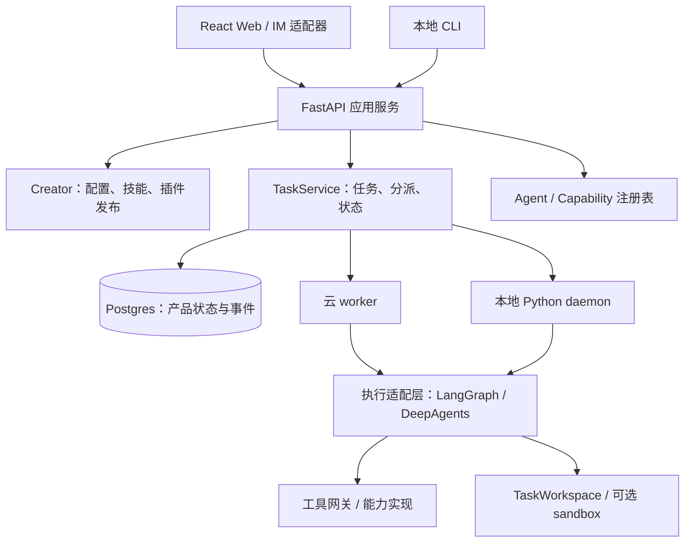

# 架构总览

状态：设计基线；实现前须完成 M0 版本冻结与执行验证。本文不声明尚未核实的框架版本或 API。

数据与状态以 [领域模型](../domain-model.md) 为规范来源，接口以 [API 与事件](../api-and-events.md) 为准。v0.1 使用 `Space(kind=personal/team)`，`tenant_id = space_id`；下文团队归属不是执行文件 workspace。

## 产品边界

个人助手与数字员工共用同一 Agent 基座。它们的差异来自归属、能力、任务和授权配置，而不是两套继承体系。AgentRevision 描述不可变的行为版本；AgentInstance 是持续存在的身份，绑定个人或团队 Space，并引用已发布版本。

用户发布任务前明确选择 `local` 或 `cloud`。本地任务由 Python daemon 执行；云端任务直接由云 worker 执行。电脑关机后，已发布的云端任务继续工作；本地任务等待设备恢复。本阶段不实现任务自动迁移，也不要求本地离线模型。

## 模块与依赖方向

以模块化单体起步：API 与 worker 可以独立进程部署，但复用同一领域代码和数据库。不在第一阶段拆微服务，也不引入第二套 runtime 或 Temporal。

| 边界 | 权威来源 | 不承担的职责 |
| --- | --- | --- |
| AgentRegistry | revision、实例归属、部署配置 | 不保存运行中进程 |
| TaskService | 任务、负责人、父子依赖、状态与租约 | 不依赖模型理解实现排他 |
| Runtime | 框架执行、checkpoint、事件转换 | 不自行授予权限或创建员工身份 |
| CapabilityRegistry / 工具网关 | 能力契约、授权检查、调用记录 | skills 不绕过此边界 |
| WorkspaceService | TaskWorkspace、文件、产物引用、session 资源 | 不把群聊历史当文件系统 |
| Creator | 可审阅草稿、测试证据、不可变发布包 | 不直接修改在线 revision |

## 建议的软件包边界

初期可在同一 Python 项目中使用 `domain/`、`application/`、`infrastructure/` 分层；以下名称为建议目录，不是框架 API。

- `domain/agents`、`domain/tasks`：身份、版本、状态与不变量。
- `application/creator`、`application/task_service`：用例与事务边界。
- `infrastructure/runtime`：LangGraph 控制图与 DeepAgents 执行适配。
- `infrastructure/capabilities`、`infrastructure/workspaces`：能力、连接器及环境实现。
- `entrypoints/api`、`entrypoints/worker`、`entrypoints/local_daemon`、`entrypoints/cli`：进程入口。
- `web/`：TypeScript / React；原生桌面客户端后置。

## 一次协同工作的展开

用户把员工实例加入 IM 群；成员关系只改变消息路由与可见性。同 tenant 中，统筹 Agent 将目标拆成每位员工独立负责的子 Task，经 TaskService 分派。跨个人/团队 tenant 使用 DelegationRequest，在接收方创建自己的 Task，再返回授权范围内的结果；不使用跨 tenant 的 parent_task_id。Worker 返回结构化结果与 Artifact 引用，统筹 Agent 验收并汇总。框架临时 subagent 不表示另一位持久员工。

MVP 仅支持同部署中预授权的个人/单团队合作 pair；加入群聊不建立委托授权。跨部署 A2A 后置。

Conversation 保存交互上下文；Task 表示工作合同；RunAttempt 表示一次执行尝试；ExecutionSession 管理执行资源。这四者不能相互替代，详见 [运行时](runtime.md)。

## 官方依据

- [LangGraph：状态化编排运行时](https://docs.langchain.com/oss/python/langgraph/overview)。
- [Deep Agents：规划、工具、文件与临时委派 harness](https://docs.langchain.com/oss/python/deepagents/overview)。
