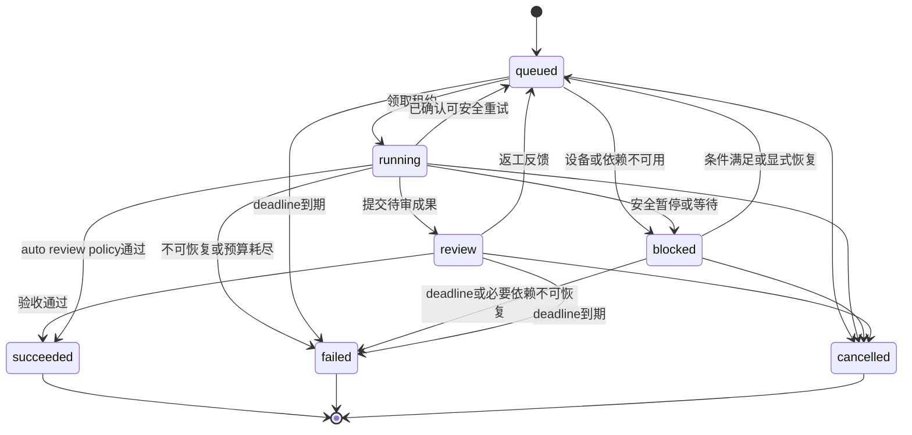

# 领域模型与状态合同

状态：v0.1 设计基线，尚未实现。日期：2026-11-15。本文是数据、状态、隔离和恢复语义的规范来源；冲突时先修订本文及对应 ADR，再修改实现。

## 1. 核心不变量

1. 个人助手／数字员工是归属与授权维度，`local/cloud` 是任务执行位置；创建任务时显式选择，创建后不隐式改变。
2. 云任务由独立 worker 执行，HTTP 请求或客户端断连不影响其生命周期。本地任务依赖已配对设备在线，不自动迁云。
3. 一个 Task 只有一个负责人 `assignee_agent_instance_id`；分工产生子 Task。一个员工可以拥有多个独立任务。
4. 群聊 Conversation 与 Agent 私有 ExecutionSession 分开。群聊历史不自动进入全部 Agent 的上下文。
5. 同一 Task 只有一个有效执行租约；重派增加 `fence`。旧执行者的状态写入、工具派发和产物发布必须被拒绝。
6. AgentRevision 发布后不可变。Task 绑定已授权的具体 revision、能力锁定清单、策略版本和预算；更新实例默认版本只影响新任务。
7. 检查点、工作文件与业务状态分别持久化。保存聊天记录不等于完成崩溃恢复。
8. 不承诺外部副作用 exactly-once。无法确认是否已发送、付款或写入的调用进入人工核对流程，禁止盲目重放。
9. 个人和团队 Space 是独立数据边界。跨 Space 委派经过目标方受理与显式结果共享，不复制调用方权限。
10. 任务、检查点和沙箱的删除分别管理。任务完成后可以释放计算，但产物与审计记录遵循保留策略。

## 2. 术语与实体

| 实体 | 定义与关键字段 | 建议首现阶段 |
| --- | --- | --- |
| Space | `id, kind(personal/team), owner_user_id`；v0.1 中 `tenant_id = space_id`，是所有持久资源的隔离键 | M1 |
| Membership | `space_id, user_id, role(owner/admin/member)`；细分动作授权独立于角色 | M1 |
| AgentDefinition | 稳定定义目录项：`id, space_id, name`，不包含用户凭据 | M1 |
| AgentDraft | Creator 可变草稿：`definition_id, spec, row_version, validation_digest`；编辑使旧验证失效 | M5 |
| AgentRevision | 已发布不可变版本：`id, definition_id, version, spec, lock, content_digest, validation_report_id` | M1/M5 |
| AgentInstance | 长期身份：`id, space_id, owner_kind(personal/team), active_revision_id, policy_binding, delegation_bindings, memory_namespace` | M1 |
| Project / Conversation | 项目、群／私聊／任务线程与成员授权；一个 Conversation 可包含多个 Task | M4 |
| Task | 工作目标：`id, space_id, parent_task_id?, assignee_agent_instance_id, revision_id, execution, input_refs, acceptance_contract, state, budget, review_policy, deadline_at` | M1 |
| ExecutionSession | `(space_id, agent_instance_id, task_id)` 唯一；拥有框架 thread 映射、上下文和 checkpoint 引用 | M1 |
| RunAttempt | 一次执行：`task_id, session_id, attempt_no, lease_owner, lease_expires_at, fence, checkpoint_id, outcome` | M1 |
| TaskWorkspace | 持久逻辑工作目录：`space_id, task_id, location, storage_ref, manifest_version` | M2 |
| SandboxLease | 计算资源：`session_id, provider, environment_id, expires_at, status`，不能作为业务状态来源 | M2 |
| ToolInvocation | `task_id, call_id, action_key, args_digest, state, provider_receipt, fence` | M2 |
| Approval | 绑定 `task_id, revision_digest, action_key, args_digest, resource_scope, expires_at, approver_id` 的一次授权决定 | M3 |
| DelegationRequest | 跨 Space 请求与受理凭据；源、目标各保留受限视图，不把目标 Task 作为源方可读取资源 | M4 |
| ArtifactVersion | `space_id, artifact_id, version, task_id, storage_ref, sha256, mime_type, provenance`，发布后版本不可变 | M2 |
| Grant / MemoryRecord | 有范围的共享授权；带来源、owner、scope、版本和保留策略的长期记忆 | M3/M4 |
| DomainEvent / Outbox | 状态变化与通知事务内写入；worker/UI 至少一次投递，以 event_id 去重 | M1 |

`AgentSpec` 是 AgentRevision 内的声明数据，示例见 [配置 schema](../schemas/agent-revision.schema.json)。不要把 LangGraph 状态对象直接当业务表，也不要将框架 subagent 字典作为长期员工身份。

`delegation.allowed_roles` 是定义中可委派的稳定角色别名，例如 researcher/analyst；AgentInstance 的 delegation_bindings 将角色映射到已获授权的实例或跨 Space delegation pair。Task创建时保存实际绑定快照。模板不含另一个部署的实例ID；绑定变化需重新授权，仅影响新Task。

Task 的 `acceptance_contract` 固定必要产物类型、逐项验收criteria及可选结构化result_schema；JSON结果由服务端真实验证。AgentRevision输出合同是基础约束，任务合同只能细化，不能取消能力与权限要求。children采用同一创建合同。goal、execution与权限范围实质变化须创建新Task；补充资料和review反馈作为追加事件保存。

## 3. Task 状态机

唯一状态枚举：`queued / running / blocked / review / succeeded / failed / cancelled`。

`blocked_reason` 唯一枚举：`waiting_device / waiting_approval / waiting_input / waiting_dependency / user_paused / recovery_required`。只有 `state=blocked` 时非空。

状态改变必须由 TaskService 校验前置条件并原子追加事件。`queued -> running` 必须与创建 RunAttempt、增加 fence 和预算预留在一个事务中完成。

| 操作 | 条件与结果 |
| --- | --- |
| pause | queued 可立即进入 blocked/user_paused；running 先记录 pause_requested，在安全步骤边界持久化 checkpoint 后释放租约并阻塞；不宣称冻结任意进程 |
| resume | 仅 blocked，且原因已解除；转 queued，由调度器创建新 RunAttempt。恢复不会扩大预算、权限或更换位置 |
| cancel | 撤销后续执行权，转 cancelled，尽力停止工具与沙箱；已发生外部操作不能承诺回滚，未知操作仍记录核对事件 |
| retry | failed/cancelled 不复活；新建 Task 并设置 retry_of_task_id，重新确认输入、位置、预算及权限 |
| review accept | 检查产物版本、验收结果和 review 授权，原子转 succeeded |
| review rework | 追加结构化反馈，转 queued，沿用 session 与 revision；任务目标或权限范围有实质变化则新建 Task |
| lease lost | 先将旧 fence 失效；可确认安全时从持久 checkpoint 新 attempt；未知副作用则 blocked/recovery_required |

`review_policy=human` 为 MVP 默认，最终交付先进入 review；内部只读子任务可配置经服务端允许的 auto，经过 schema/文件存在性等检查后成功。Agent 自称完成不直接等于人审通过。

### 阻塞条件如何解除

| 原因 | 解除操作 | 恢复输入与结果 |
| --- | --- | --- |
| waiting_device | 已配对设备重连并完成fence/未确认结果核对 | 安全时queued；未知动作仍recovery_required |
| waiting_approval | 有权者approve/reject或审批过期 | approve注入已绑定授权；reject/过期记录denied observation后queued，Agent可在原权限内调整，无法完成则failed；同摘要不得反复申请绕过拒绝 |
| waiting_input | 有权者追加结构化资料或artifact引用 | 追加input事件并验证ACL后queued；改变目标/授权范围则新Task |
| waiting_dependency | 必需子任务成功或显式制定失败处理决定 | 注入受限结果后queued；不可恢复依赖失败按策略failed，不能永远等待终态依赖 |
| user_paused | 用户显式resume且未超过deadline | queued，新attempt引用原checkpoint |
| recovery_required | 有权者依据证据确认已完成／未执行／放弃 | 已完成登记receipt与结果后queued；未执行且旧进程已终止才允许原意图重试；放弃转failed/cancelled并保留核对记录 |

## 4. Session、Run 与任务恢复

- ExecutionSession 的框架 thread_id 由服务端生成，映射包含 Space、AgentInstance、Task 和 revision；客户端不可指定任意 thread_id。
- 一个 session 可以跨多个 RunAttempt，但每次 attempt 只有一个有效执行者。MVP 中一个 RunAttempt 对应一次持久执行段，而不是把每个 token/model call 当作 attempt。
- 工具审批保存 pending call 和 checkpoint 后进入 blocked/waiting_approval，并释放运行租约。批准后新 attempt 从同一 session 的 checkpoint 恢复，调用前再次验证摘要与权限。
- graph 可能在恢复时重新进入节点；有副作用的动作统一经过 ToolGateway，以稳定 action_key 和账本判重。不能只在 graph 节点内发请求再依赖 checkpoint。
- action_key关联持久tool intent，不从attempt_no或重新生成的模型call_id直接构造。恢复先核对未完成intent；检查点与调用账本不一致时由reconciler处理，不能直接生成第二次写入。
- session checkpoint 不包含唯一的产物副本或长期主凭据；恢复能力须以故障注入实验验证。

## 5. 子任务和跨 Space 委派

同 Space：父 Task 创建子 Task，绑定目标员工、输入授权引用、结果 schema、预算和深度限制。父任务等待未完成的必要依赖；并行分支只写自己的 TaskWorkspace，合并通过版本化产物完成。

跨 Space：源方创建 DelegationRequest；目标方检查已批准的 Agent pair、scope、预算承担者和输入可见性，受理后在目标 Space 创建 Task。`parent_task_id` 只允许同 Space；跨 Space 使用受限 delegation 关联。源方只能收到被目标方允许共享的结果／状态，不可据关联 ID 读取私有日志、记忆或账号。

MVP 必须支持同一部署内个人空间与一个团队空间的预授权协作；跨部署联邦、任意第三方 A2A 后置。群成员邀请和委派授权分开记录。

## 6. 最小存储约束

- 所有业务查询带服务端计算的 space_id；不能使用客户端传入的 tenant_id 直接查询。跨 Space 只走受理及共享服务。
- 唯一约束：`(space_id, agent_instance_id, task_id)` session；`(task_id, attempt_no)` attempt；`(session_id, call_id)` invocation；创建请求幂等键 `(principal_id, route_scope, idempotency_key)`。
- Task `row_version`、租约 fence、ArtifactVersion 的乐观并发控制分别服务不同目的，不相互替代。
- Task 状态、DomainEvent 和 Outbox 同事务提交。PostgreSQL 持久队列允许多 worker 认领，lease TTL/heartbeat 均可配置并测试。
- 输入、产物使用 opaque ID + ACL，禁止把任意本地绝对路径、对象存储 key 或下载 URL 当作授权证明。
- 记忆默认按个人／员工／项目分别存储。并发写带版本及来源；跨项目自动学习、无审阅修改系统提示词后置。
- M1-M4 可合并部分表以降低成本，但上述唯一约束、隔离和事件语义不能省略；DDL 由实际 migration 定义。

## 7. 预算计量合同

- max_model_calls、max_tool_calls、max_runtime_seconds累计计算同Task各attempt，恢复不清零。runtime指活跃执行秒数，blocked/review/排队等待不计入；并行分支的活跃秒数相加。
- 父Task分派前为子Task预留额度；父预算覆盖自身及子树。子完成只结算一次实际用量并释放未用预留，不能父子重复扣除同一笔消费。临时subagent也计入同一预算。
- max_cost_usd为基于provider定价/用量的估算限制；调用前保守预留并结合调用次数硬限制，不承诺与供应商最终账单绝对相等。取消后在途调用可能产生尾差，必须记账并停止新调用。
- 所有Task另有deadline_at，默认创建后24小时，可在创建时收紧；超过deadline不再执行新步骤，由服务标记failed/deadline_exceeded并清理。等待不计活跃秒数，但不越过deadline。
- 跨Space由接收方owner在受理时批准预算和账户，实际provider消费记接收方账。源方为委派预留上限并按受限用量回执做父任务总量核算，不再产生第二笔provider收费；无法核对用量时不能释放整个预留后继续超发。
- 首版并发/递归上限由部署策略和声明共同约束，取更小值；owner可见用量，模型无权自行提高上限。

## 8. 示例

团队群接到研究任务，统筹员工创建云 Task A。研究员子任务 B、分析员子任务 C 均在团队 Space，各有独立 session/workspace。个人助手通过 DelegationRequest D 提供获授权的资料摘要，目标任务位于个人 Space。A 只引用 D 被批准共享的产物，收齐结果后进入 review。

本地任务 L 在设备离线时进入 blocked/waiting_device；设备回来后 queued -> 新 attempt。L 的 execution.target 不改变。用户另选云端执行时，新建 Task L2，显式选择可共享输入并关联来源。
